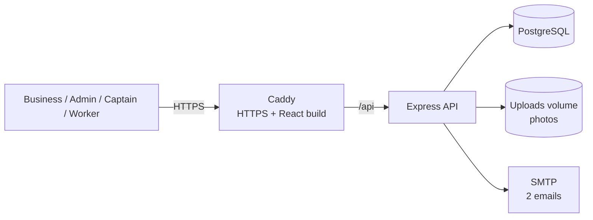

# HerHandmade

A small, mobile-first platform for an NGO that connects **businesses placing bulk orders** (rakhis, giftables) with **village women's groups** who make them.

1. A business submits an order on a public form and gets a tracking link by email.
2. The admin finds the best groups for the item (by skill rating and availability) and assigns work.
3. The Sakhi Captain (group leader) accepts, uploads proof photos and marks the work done.
4. The business sees admin-approved photos, labelled with village and district, on its tracking page.

> New here? Start with **[help.md](help.md)**: setup, the `.env` file, what every file does, and how to go live.

---

## 1. Who uses it

| Actor | Login | Can do |
|---|---|---|
| **Business** | None. Public form + emailed tracking link | Place an order, track it, see approved photos |
| **Admin** (NGO) | Phone + password | Manage orders and captains, match groups, assign work, approve photos, post to groups |
| **Sakhi Captain** (leader) | Phone + password | Accept or decline tasks, upload photos, mark done, manage roster, post to her group |
| **Worker** | None. Opens the group link `/g/<code>` | Read-only: the group's tasks and posts |

In code the leader role is always `leader`. "Sakhi Captain" is only display text in the translation files.

**Scale target:** 10,000 orders a month, 100 groups, 50 women per group. That is a few requests per minute, so one small server is plenty.

## 2. Tech stack

| Layer | Choice |
|---|---|
| Frontend | React 18, Vite, React Router, Axios, plain CSS (mobile-first), react-i18next (English, Hindi, Kannada) |
| Backend | Node.js 20, Express 4, `pg` (raw SQL, no ORM), Zod, multer, nodemailer |
| Database | PostgreSQL 16, whole schema in [`backend/db/schema.sql`](backend/db/schema.sql) |
| Auth | JWT in an `httpOnly` cookie, bcrypt |
| Tests | Jest + Supertest (backend, 71 tests), Vitest + React Testing Library (frontend, 12 tests) |
| DevOps | Docker, docker-compose, Caddy (automatic HTTPS), GitHub Actions (lint, test, build) |

## 3. Architecture



One Node process, one database, one server. Every feature is a folder under `backend/src/modules/` with the same four files:

```
x.routes.js      the URL, and which middleware runs        (no logic)
x.controller.js  reads the request, calls the service, sends the answer   (no rules)
x.schema.js      Zod validation of body, query and params
x.service.js     the business rules and the SQL
```

Request path: `rate limit → requireAuth → requireRole → validate → controller → service → SQL`.

Every error looks like `{ "code": "INVALID_TRANSITION", "message": "..." }`. The frontend translates the **code**, never the English message.

**Ownership is enforced inside the SQL.** A captain's queries always filter on her own group and only select `order_ref` and `item` from orders, so she can never receive business details.

## 4. Data model

| Table | Purpose |
|---|---|
| `users` | Admins and captains (`role`: `admin` or `leader`) |
| `groups` | One group per captain: village, district, and the worker `access_code` |
| `members` | Optional roster (names only) |
| `skills` / `group_skills` | Skills with aliases ("rakhi", "rakhee", "राखी"), and each group's rating 1-5 per skill |
| `orders` / `order_events` | Business orders (with an unguessable `tracking_token`), and one row per status change |
| `assignments` | Part of an order given to one group. **One order → many assignments** |
| `assignment_media` | Reference images and proof photos (random file names) |
| `broadcasts` | Posts: text, photo, or YouTube link |

The database enforces the basics (ratings 1-5, valid statuses, unique phones, a video post must have a link). Performance numbers: [`docs/PERFORMANCE.md`](docs/PERFORMANCE.md).

## 5. Statuses

**Order** is changed **only by the admin**, one allowed move at a time (`TRANSITIONS` in `backend/src/constants.js`):

```
submitted → accepted → in_production → completed → dispatched → delivered
    ↘ rejected / cancelled (from submitted or accepted)
```

Any other move returns `409 INVALID_TRANSITION`. `completed` needs every assignment done (`ASSIGNMENT_OPEN`). `dispatched` emails the business. Cancelling closes the group's open assignments.

**Assignment** is driven by the captain: `assigned → accepted | declined`, then `accepted → done`.

| Rule | Where |
|---|---|
| Sum of non-declined quantities ≤ order quantity (`QUANTITY_EXCEEDED`) | `assignments.service.js`, in a transaction with the order row locked (`FOR UPDATE`) |
| Assignment deadline ≤ order delivery date | `assignments.service.js` |
| **Done** needs at least one photo (`EVIDENCE_REQUIRED`) | `assignments.service.js` |
| A new photo resets the admin's approval | `assignments.service.js` |

## 6. Key features

### Group matching (headline feature)

`GET /api/groups/match?q=rakhi&mode=best_rated`

1. Find the skill by name or alias (`rakhi`, `rakhee`, `राखी` all work).
2. SQL returns every active group with that skill plus its open assignments: queue length, current task, and **next free date** (the latest open deadline; empty = free now).
3. Code sorts and returns the top 10:

| Mode | Order |
|---|---|
| `best_rated` (default) | rating high to low, then free-now first, then soonest free |
| `fastest` | free-now first, then soonest free, then rating high to low |

The sorting lives in `modules/groups/groups.service.js` and the rating rules in **`modules/groups/ratingPolicy.js`** (only the admin sets ratings; `effectiveRating()` is the one place to blend in on-time delivery % later).

### Proof of handmade origin

The captain uploads 1-5 photos (shrunk on her phone, which also removes hidden GPS data). The admin deletes any bad photo, then presses **Approve** once per assignment. The business's tracking page shows only approved photos, each labelled **"Village, District"**, plus the NGO's contact details. It never shows a group name, captain name or phone number.

### Worker link (no accounts)

Each group has an 8-character code (like `K7M2-9QXA`). The captain shares `/g/<code>` on WhatsApp. It shows the group's accepted tasks and posts, read-only. She can make a new link at any time and the old one stops working. The system stores **no phone number or email for any woman**.

### Posts

| Author | Audience |
|---|---|
| Admin | all groups, or one captain |
| Captain | her own group only (the server sets the target) |

Types: text, photo (uploaded), or video. **Videos are YouTube links**: upload them to YouTube as *Unlisted* and paste the link (see help.md).

### Live updates

Dashboards refresh every 30 seconds and have a Refresh button. Real-time push is a possible later addition.

## 7. API routes

Base `/api`. JSON, except photo uploads (`multipart/form-data`). Lists use `?page=1&limit=20` and return `{ items, page, limit, total }`. Full walkthrough with real responses: [`docs/API_TESTING.md`](docs/API_TESTING.md).

| Module | Method and path | Who |
|---|---|---|
| **public** | `POST /public/orders` | anyone (rate limited, honeypot) |
| | `GET /public/track/:token` | business |
| | `GET /public/track/:token/photos/:mediaId` | business (approved photos only) |
| | `GET /public/group-view/:code` | worker link |
| | `GET /public/group-view/:code/media/:fileName` | worker link (post images) |
| **auth** | `POST /auth/login`, `POST /auth/logout`, `GET /auth/me` | all |
| **skills** | `GET /skills` | admin, leader |
| | `POST /skills` | admin |
| **captains** | `GET /captains`, `POST /captains` (creates login + group) | admin |
| | `PUT /captains/:id/password`, `DELETE /captains/:id` (deactivate) | admin |
| **groups** | `GET /groups/match?q=&mode=` | admin |
| | `PUT /groups/:id/skills` (ratings) | admin |
| | `GET /groups/me` | leader |
| | `POST /groups/me/members`, `DELETE /groups/me/members/:memberId` | leader |
| | `POST /groups/me/access-code` (new link) | leader |
| **orders** | `GET /orders?status=&q=&page=&limit=`, `GET /orders/:id` | admin |
| | `PATCH /orders/:id/status` | admin |
| | `POST /orders/:orderId/assignments` | admin |
| **assignments** | `GET /assignments` (`?orderId=&status=`), `GET /assignments/:id` | admin, leader (own group) |
| | `POST /assignments/:id/reference` (images) | admin |
| | `PATCH /assignments/:id/approve`, `DELETE /assignments/:id/evidence/:mediaId` | admin |
| | `PATCH /assignments/:id/response` (accept / decline) | leader |
| | `POST /assignments/:id/evidence` (photos), `PATCH /assignments/:id/done` | leader |
| **broadcasts** | `POST /broadcasts`, `GET /broadcasts`, `DELETE /broadcasts/:id` | admin, leader (delete: author or admin) |
| **media** | `GET /media/:fileName` | any logged-in user |

**Error codes:** `VALIDATION_ERROR`, `INVALID_ID`, `DEADLINE_AFTER_DELIVERY` (400) · `UNAUTHENTICATED`, `INVALID_CREDENTIALS`, `INVALID_ACCESS_CODE` (401) · `FORBIDDEN` (403) · `NOT_FOUND`, `SKILL_NOT_FOUND` (404) · `INVALID_TRANSITION`, `QUANTITY_EXCEEDED`, `EVIDENCE_REQUIRED`, `ASSIGNMENT_OPEN`, `ALREADY_EXISTS` (409) · `FILE_TOO_LARGE` (413) · `UNSUPPORTED_FILE` (415) · `TOO_MANY_REQUESTS` (429) · `INTERNAL_ERROR` (500).

## 8. Security and privacy

- `httpOnly` cookie sessions (no token in localStorage). `helmet`, CORS locked to one origin. The user is re-checked in the database on every request, so a deactivated captain is locked out at once.
- Rate limits on login, the public order form and the group link.
- Zod validation on every route. Uploads: type and size limits, and the real file type is checked from the file's first bytes.
- Captains and workers never receive business name, contact or location. Businesses never see group or captain identity.
- Photos need admin approval before a business sees them. File names are random 128-bit values, and `/api/media` requires login.
- Deactivating a captain blocks her login, removes her group from matching, and disables her group link.

## 9. Project layout

```
herhandmade/
├─ help.md                  start here: setup, .env, what every file does
├─ docker-compose.yml  Caddyfile  .env.example
├─ .github/workflows/ci.yml
├─ scripts/backup.sh
├─ docs/                    API_TESTING.md (Postman), PERFORMANCE.md
├─ backend/
│  ├─ db/schema.sql
│  ├─ scripts/              init-db.js, seed.js, seed-bulk-orders.js
│  ├─ src/                  app.js, server.js, db.js, constants.js, config/, middleware/, utils/, services/
│  │  └─ modules/           auth, captains, skills, groups, orders, assignments, broadcasts, media, public
│  └─ tests/
└─ frontend/
   └─ src/                  pages/ (public, admin, captain), components/, i18n/, context/, hooks/, tests/
```

## 10. Testing

| Where | Command | Covers |
|---|---|---|
| Backend | `cd backend && npm test` | 71 tests on a real PostgreSQL test database: order and assignment rules, quantity cap, matching in both modes, ratings, uploads, **privacy checks** (captains get no business data, unapproved photos never public, other groups' files unreachable), auth, rate limiting |
| Frontend | `cd frontend && npm test` | 12 tests: login, order form validation, protected routes, helpers |
| Lint | `npm run lint` in each folder | Code style |
| API by hand | [`docs/API_TESTING.md`](docs/API_TESTING.md) | Postman walkthrough with real responses |

## 11. Decisions and "what I'd add next"

| Today | Why | Next step |
|---|---|---|
| PostgreSQL, raw SQL | Relational data; constraints and transactions protect the rules | A query builder, only if SQL becomes repetitive |
| Modular monolith | Tiny load | Split only if one module must scale alone |
| Admin controls order status by hand | Keeps order and assignment code independent | Auto-update from assignments |
| 30-second refresh | Simple and enough | Socket.IO live push |
| Page-number paging, `ILIKE` search | Fast enough at ~120k orders a year (see PERFORMANCE.md) | Keyset paging, trigram index |
| `/api/media` needs login, random names | Simple | Per-group checks or signed, expiring URLs |
| Photos on the server disk (`services/storage.js`) | Cheapest | Object storage if the disk fills (worst case ~90 GB a year) |
| Photos approved once per assignment | One flag, one button | Per-photo approval |
| Videos as YouTube links | No storage or bandwidth cost | Direct upload |
| No cleanup job for old reference images | One less thing to break | A small script |
| Manual deploy | No secrets in CI | Auto-deploy from GitHub Actions |

**Known limitations:** photo authenticity cannot be guaranteed technically (admin review and the NGO's reputation are the safeguards). Post text is not auto-translated. There is no offline mode. Hindi and Kannada text should be checked by a native speaker.
